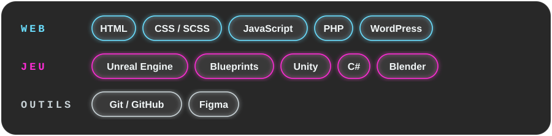

 

 

## Qui je suis

Passionné par toutes choses multimédias, j’aime particulièrement tous les types de programmation, et tout autant l’aspect humain de chaque projet.

J’offre mon **attention au détail**, mon **assiduité** et ma facilité à **créer des liens humains**. Je contribue aux projets grâce à mon **habileté technique** et à ma capacité d’**optimiser mes méthodes de travail** pour livrer un projet de meilleure qualité, plus efficacement.

## Technologies

## Projets

| Projet                                                                                                 | Contexte                                | Technologies                                                                                       |
| :----------------------------------------------------------------------------------------------------- | :-------------------------------------- | :------------------------------------------------------------------------------------------------- |
| **Niveau de jeu d’évasion**   Pyramide égyptienne, énigmes programmées en Blueprints                | Projet scolaire · 2025                  | Unreal Engine, Blueprints, Blender · [Code source](https://github.com/guidscal/Niveau-Jeu-Evasion) |
| **WebJam : un site complet en 36 h**   Intégration HTML/CSS/JS, WordPress et PHP, en équipe de cinq | 🏆 Gagnant, compétition scolaire · 2025 | HTML, CSS, JavaScript, PHP, WordPress, Figma                                                       |
| **Traducteur de symboles en réalité augmentée**   Application multimédia                            | Contrat pour La Clef de l’Énigme · 2025 | Unity, C#, Blender                                                                                 |
| **Site web pour Le Nid Bleu**   Site d’un OBNL au service des adultes TSA                           | Contrat · 2026                          | HTML, CSS, JavaScript, PHP, WordPress, Figma                                                       |
| **Jeu sur Unreal avec des bâtiments d’autres étudiants**   Intégration et optimisation de ceux-ci   | Projet scolaire · 2025                  | Unreal Engine, Blender                                                                             |

Tous les détails, étape par étape, sont sur [mon portfolio](https://guillaumecallebert.dev/aboutme#projectlist).

## Habiletés

- Programmation **nodale** optimisée et gestion du niveau **back-end**
- **Optimisation** de médias divers
- Utilisation de logiciels de **versionnage**
- Utilisation **intelligente** de l’intelligence artificielle : savoir l’encadrer, valider et déboguer ce qu’elle propose

## En dehors du code

Les jeux vidéo, les gadgets technologiques, l’histoire, les voyages et la Formule 1.

Ce profil reprend l’univers visuel de [mon portfolio](https://guillaumecallebert.dev). Ses animations ont été réalisées avec l’aide de Claude (Anthropic), comme expliqué dans [ma déclaration d’utilisation de l’IA](https://guillaumecallebert.dev/aboutme#declaration-ia).

